# Hotdog or Not

- **Author:** Project owner, assisted by Codex
- **Status:** Implementation baseline — user authorized implementation on 28 October 2026
- **Date:** 28 October 2026
- **Name:** Hotdog or Not; working repository name `hotdog-or-not`

## Implementation updates — 28 October 2026

Two later user instructions supersede the corresponding original plan details below:

- **Reuse HashtagConnect's configuration:** local recognition now uses the same three server-side Cloudflare environment values and native HTTP request path as the sibling. The existing inference token is active but cannot list accounts for Void's binding setup. Native `fetch` calls the Workers AI endpoint with the experimental image header and Gateway logging/cache disabled. A real call confirmed the completed response envelope; automated tests mock fetch. No extra sign-in or broader token permissions are needed for local recognition. The app retains its own Worker identity and does not copy deployment state.
- **Build the whole app around the camera:** the viewfinder fills the viewport. The editable object name floats at the top, the shutter sits at the bottom, and the binary verdict appears on the captured photo. The separate columns, numbered steps, large wordmark, and marketing copy were removed. Camera access still starts with an explicit user action.

The remaining product behavior is unchanged. See the current architecture and verification records for the implemented transport, layout, and actual test evidence. The detailed plan below records the earlier design decisions; these updates take precedence where it differs.

## Overview

Hotdog or Not is a personal hobby application for checking whether the main subject of a photo matches a chosen object name. A single text field starts with the object name “hotdog”; the user can replace it with another object name. The central experience is entering a name, framing a subject in a live camera preview, tapping to capture a photo, and seeing an answer tied to that object and photo.

The project will have public source and live beside HashtagConnect. It will reuse that project's Void, React, TypeScript, Vite+, and pnpm setup and adapt its AGENTS.md rules. File organization, naming, and responsibility boundaries will be explicit and enforced where the existing tools support them.

The first-release goals are accepted. The user selected the original app's capture interaction: live camera preview, explicit capture, then one verdict for the captured photo. Target entry is by name only, with no preset chooser. A match concerns the main photographed subject; a target object visible only in the background does not establish a match. Every completed check returns either the target name or “Not” followed by that name, including when the evidence is ambiguous. Recognition uses Jev through Cloudflare, as selected by the user.

## The Problem

The requested experience is a small visual experiment: ask whether something is a hotdog, then repeat the question for another object. A detector limited to one fixed target would miss the requested ability to switch objects. A result also needs to make its subject clear, so the user can tell what was checked and interpret the answer.

The engineering need is a maintainable public project that a contributor can navigate and run. The owner wants tighter organization than the sibling application's current layout. Consistent responsibilities, names, and checks should make the intended location of a change apparent without requiring knowledge of this conversation.

This is an owner-directed hobby project. No market demand, recognition accuracy, or performance result has been established. Those claims should not be invented to justify the application.

## Goals

1. **Complete the core recognition loop.** Start with hotdog as the initial target. Let the user frame a subject in a live camera preview and tap to capture a photo. Assess once whether the photo's main subject matches the selected target, and show which photo and target the assessment concerns. Include the framing hint “Fill the frame with the object.”
2. **Let the user change the object by name.** Provide one editable text field, prefilled with “hotdog,” for the target object name. The user can enter another name without modifying application code or choosing from a fixed list. After a change, the interface must make clear which target any displayed result belongs to.
3. **Keep completed results binary.** Return “X” or “Not X” for the entered object name. A completed check makes its best judgment even for ambiguous photos; there is no “Can't tell” verdict. An unavailable or failed check is an error, distinct from a completed negative result.
4. **Keep the interaction focused and accessible.** Make the current target, input action, and result easy to find. The core controls must have clear labels and work with keyboard and touch input. The design should not require familiarity with the model or its API.
5. **Make the source usable by contributors.** Document the runtime, installation, configuration, development, and verification steps. A contributor should be able to use their own configuration without access to the owner's machine or private credentials. The source license and publication destination must be settled before release.
6. **Enforce consistent organization.** Define where framework entry points, browser code, server code, and tests belong. Set naming and import conventions in the project's rules and apply existing tooling to enforce them. Create boundaries for actual responsibilities, with no empty layers reserved for hypothetical features.
7. **Verify behavior and describe limits honestly.** Cover the recognition flow and target changes with meaningful checks. Use mocked provider responses for automated integration tests. Evaluate real recognition behavior separately before making accuracy or latency claims; document the limitations observed.

## Non-Goals

The first release excludes:

- HashtagConnect's social discovery, X integration, profile matching, and community features.
- Training or fine-tuning a model, collecting a training dataset, or building a general-purpose model platform.
- Object counting, inventory management, and persistent object tracking.
- User accounts, social feeds, shared galleries, subscriptions, and administration dashboards.
- Continuous recognition while the camera is moving.
- On-device model inference.

A hosted demo remains an open release decision.

## Critical User Journeys

### First check

- **Given:** The user opens the application with “hotdog” in the object-name field and grants camera access.
- **When:** The user frames the subject in the live preview and taps the capture button.
- **Then:** The interface shows the captured photo and an assessment for hotdog, or explains that the check could not complete.

### Change the target

- **Given:** The user has entered or checked one object name.
- **When:** The user replaces the name in the text field, frames a subject, and taps to capture another photo.
- **Then:** The new assessment identifies the new target. A previous assessment remains identifiable as belonging to its original target if it is still visible.

A check starts when the user taps to capture. Moving the camera does not start more checks. Changing the target selects the object for the next capture.

### Distinguish the subject from the background

- **Given:** The target name is “mug.”
- **When:** The user captures a photo clearly focused on a laptop, with a mug in the background.
- **Then:** The intended verdict is “Not mug.” A subsequent photo focused on the mug should produce “Mug.” This example defines the desired behavior; model accuracy still needs evaluation.

## Technical Plan

The user approved this Technical Plan on 28 October 2026. It defines the implementation mechanisms for the agreed behavior; the live-verification limits below remain applicable.

### Application and request flow

Build one Void application with a React page and one synchronous API endpoint on Cloudflare Workers. Reuse the sibling's pnpm, TypeScript, Vite+, formatting, linting, and test setup. The app holds the current capture and result in browser memory; it needs no database, object store, or job queue for this flow.

```mermaid
flowchart LR
    A[Object name and live camera] -->|User taps capture| B[Prepared JPEG and captured target name]
    B -->|Void typed fetch| C[POST /api/recognitions]
    C --> D[Validate request]
    D -->|Native Void AI call| E[Cloudflare AI Gateway]
    E --> F[Jev: main-subject question]
    F --> G[Noul answer]
    G --> H[Map answer to binary verdict]
    H --> I[Photo with X or Not X]
```

### Camera and screen behavior

Use the browser's `getUserMedia` API with video enabled, audio disabled, and a preference for the rear camera. Ask for camera access after the user activates the camera control. A denied permission, unavailable camera, or unsupported context receives a clear camera error with recovery guidance. Camera access needs HTTPS or a permitted local development origin. [Browser camera API](https://developer.mozilla.org/en-US/docs/Web/API/MediaDevices/getUserMedia)

The preview displays the full frame without a different crop from the submitted image. A capture records the current frame and trimmed target name together. While recognition is pending, disable capture and target editing. The result uses that captured name; later edits apply to the next capture and do not relabel a previous answer.

Release the camera tracks when leaving the live preview or unmounting the screen. Retake returns to the camera. A service error retains the captured photo and name so the user can explicitly retry. There are no automatic inference retries or checks triggered by camera movement.

Use native controls with visible labels, keyboard operation, a visible focus indicator, and an announced result/error region. Browser camera APIs run only in browser lifecycle code or user actions, so the page shell can render on the server.

The sibling's `camera=()` permissions policy must be adapted to `camera=(self)` for this app. Keep microphone access disabled. [Camera permissions policy](https://developer.mozilla.org/en-US/docs/Web/HTTP/Reference/Headers/Permissions-Policy/camera)

### Image preparation and the HTTP contract

Use a browser canvas to export an upright JPEG of the captured frame. Preserve the subject's proportions, cap the longest edge at 1280 pixels, and use padding only when necessary to keep both output dimensions within the model's accepted range. The displayed result uses the prepared image. Canvas export supplies the required JPEG format directly. [Canvas image export](https://developer.mozilla.org/en-US/docs/Web/API/HTMLCanvasElement/toBlob)

TypeSafe currently accepts PNG/JPEG with each side between 280 and 1568 pixels. Its service does not apply EXIF orientation before removing metadata, so preparing upright pixels before submission is required. The camera path avoids accepting arbitrary uploaded file formats. [TypeSafe image requirements](https://docs.typesafe.ai/images#limits)

Use Void's native JSON request validation and typed client. Base64 image data fits the model's native image asset format. The client sends only the data after the data-URL prefix.

| Contract        | Accepted shape and behavior                                                                                                                                                                             |
| --------------- | ------------------------------------------------------------------------------------------------------------------------------------------------------------------------------------------------------- |
| Route           | `POST /api/recognitions`; plural resource noun, consistent with the sibling's route conventions.                                                                                                        |
| Request         | `targetName`, `imageBase64`; JPEG is the only format produced by this capture flow.                                                                                                                     |
| Name validation | Trim whitespace; require a nonempty name of at most 80 characters. Accept names containing spaces and Unicode.                                                                                          |
| Size validation | At most 2 MiB of decoded image data and a 3 MiB JSON request. Install Hono's body-limit middleware through Void's native middleware convention, ahead of route parsing; use Zod for the request fields. |
| Success         | HTTP 200 with `targetName` and `matches: boolean`.                                                                                                                                                      |
| Errors          | Invalid input, unavailable configuration, provider failures, and limits produce non-success responses. They never produce a false matching result.                                                      |

The API handler uses `defineHandler.withValidator`; the client uses `fetch` and `FetchError` from `void/client`. The handler's native types supply the request and response contract to callers. [Void typed fetch](https://void.cloud/guide/typed-fetch)

### Jev integration and binary decision

Use model `typesafe/jev-1.14.0` with `ai.run` from `void/ai`. The installed Void 1.2.1 client forwards Cloudflare AI options, including the selected gateway, additional request headers, and cancellation signal. Cloudflare publishes a native binding example for this model. The new code can therefore use the framework API while retaining Jev and Cloudflare as requested. [Void AI API](https://void.cloud/guide/ai), [Cloudflare Jev model](https://developers.cloudflare.com/ai/models/typesafe/jev-1.14.0/)

The server submits one image asset with a unique reference, includes the photo reference and target name as separate state fields, and asks one Noul question: whether the main photographed subject is an instance of the named object. Its fixed criteria distinguish the subject from incidental background objects. The entered name is data, not the complete model instruction. Send the experimental image header through the native request options. [TypeSafe image request format](https://docs.typesafe.ai/images)

Validate the returned Noul value once at the provider boundary. Map values at or above 0.5 to `matches: true`; values below 0.5 map to `false`. The threshold chooses the more likely answer, with an exact tie assigned to the positive class. This is the accepted deterministic policy for the user's binary requirement, not a measured accuracy claim. The user sees only “X” or “Not X.” [Noul answer semantics](https://docs.typesafe.ai/primitives/noul)

Set a 20-second provider request timeout and allow one active request in the screen. Use Void's native limit handling for rate-limit responses. Other failures become a short service error; do not expose provider response bodies or credentials in the UI. Rejected input, malformed output, and missing responses remain errors and never become negative verdicts.

### Source structure and naming

Set Void's native `sourceDir` to `src`. This keeps application code together while preserving framework routing and generation. Root files are project configuration, the package lock, standard project documents, and deployment metadata. Generated files remain ignored. [Void source-directory configuration](https://void.cloud/reference/config#sourcedir)

| Location            | Responsibility                                                                 | Import direction                                          |
| ------------------- | ------------------------------------------------------------------------------ | --------------------------------------------------------- |
| `src/pages`         | Thin Void page entry points that compose the screen.                           | Client UI and browser-safe shared code.                   |
| `src/routes`        | Native HTTP handlers: validation, service invocation, HTTP response.           | Server and shared code.                                   |
| `src/middleware`    | Native request middleware, including the body-size limit before route parsing. | Shared limits and native middleware APIs.                 |
| `src/client`        | Recognition screen, camera lifecycle, capture preparation, and UI styles.      | Client siblings and shared code.                          |
| `src/server`        | Jev evaluation and conversion to the app's binary result.                      | Server siblings, shared code, and native server APIs.     |
| `src/shared`        | Browser-safe request schema, validation limits, and app result types.          | Shared code and schema dependencies only.                 |
| `src/env.ts`        | Void's environment schema for app configuration.                               | Native Void environment API; consumed only on the server. |
| `tests/integration` | Cross-module API and provider-boundary tests.                                  | Application code and test fixtures.                       |

Start with a recognition screen, a camera lifecycle module, a capture-preparation module, a shared recognition contract, and a server recognition function. Separate additional components only when they have an independent responsibility. Avoid generic dumping grounds such as miscellaneous helpers and redundant re-export files.

Use kebab-case for application files and directories; PascalCase for React components and types; camelCase for values and functions. Preserve framework-reserved names and conventional root document names. Unit tests are colocated as `*.test.ts` or `*.test.tsx`; integration tests remain under the root test directory.

Use `~/` for imports across directories, mapped to the source root in both Vite and TypeScript. Sibling imports stay relative. Native Oxlint rules enforce filename case and restrict imports: client/shared files cannot import server modules or server-only runtime APIs, and cross-directory relative imports cannot bypass the aliases. Directory ownership is also part of review. [Oxlint filename convention](https://oxc.rs/docs/guide/usage/linter/rules/unicorn/filename-case)

The new AGENTS.md retains the sibling's native-interface rule, required checks, meaningful-test policy, and doc-comment preservation. It replaces X-specific rules and the loose flat-module guidance with these explicit responsibilities. It also incorporates the user's branch, coauthor, draft-PR, and speculative-complexity rules. Avoid machine-specific paths in project documentation; document responsibilities and stable commands.

### Configuration, image handling, and verification

Use a separate app identity and native Void/Cloudflare configuration. Do not inherit HashtagConnect's resource IDs or copy its local secrets. Development uses Void's Cloudflare authentication, and native binding calls stay server-side. The selected gateway identifier is app configuration. Tests mock the native AI call and do not need to contact paid models. [Void local AI development](https://void.cloud/guide/ai#local-development)

Keep the current photo in browser memory until it is replaced or the page closes. The app does not persist captures or recognition history. Disable AI Gateway request logging and caching for these calls through its native options. These settings govern Gateway storage; they do not establish zero retention at TypeSafe or control any separately configured Logpush export. Record the actual provider processing in the app's privacy explanation. [Gateway logging controls](https://developers.cloudflare.com/ai-gateway/observability/logging/)

Keep `pnpm run check`, `pnpm test`, and `pnpm run build` as the verification entry points, with CI using the frozen lockfile. Check input validation, binary verdict mapping, provider failures, target/result association, and camera cleanup. Check the real camera flow on a phone and desktop browser. Use a small set of positive, negative, background-object, and ambiguous photos to evaluate model behavior separately from mocked tests.

Jev image support is experimental. The first live integration check must verify the native binding's response and image-header behavior; the selected approach is supported by documentation and installed API inspection but has not yet been exercised against the provider. Accuracy and end-to-end latency also remain unmeasured. [Jev image-support status](https://developers.cloudflare.com/ai/models/typesafe/jev-1.14.0/)

## Alternatives Considered

The user approved this section on 28 October 2026 and authorized the Detailed Implementation Plan.

These alternatives record the decisions made during product clarification and Technical Plan review. Rejection means an approach was not selected for this release; it does not establish that it would be unsuitable for a different product.

### Capture interaction

| Alternative                                      | Benefits                                                                                 | Costs or limitations                                                                                                                          | Reason not selected                                                                                                                                          |
| ------------------------------------------------ | ---------------------------------------------------------------------------------------- | --------------------------------------------------------------------------------------------------------------------------------------------- | ------------------------------------------------------------------------------------------------------------------------------------------------------------ |
| Continuous recognition of camera frames          | Updates the verdict as the scene changes without requiring a tap for each check.         | Repeated inference increases workload. Results can refer to an earlier frame if the scene changes before inference completes.                 | The user selected the original's live preview and explicit shutter interaction, with one completed verdict per capture.                                      |
| Capture or upload through the system file picker | Uses the platform's existing selection flow and can accept photos already on the device. | It does not provide the chosen in-app camera preview and shutter experience. Supporting it alongside that experience adds another input path. | The first release is centered on pointing the camera at a subject and capturing it in the app. File selection was not included in the selected capture flow. |

### Target entry and result meaning

| Alternative                                      | Benefits                                                                                                      | Costs or limitations                                                                                                               | Reason not selected                                                                                                                                                       |
| ------------------------------------------------ | ------------------------------------------------------------------------------------------------------------- | ---------------------------------------------------------------------------------------------------------------------------------- | ------------------------------------------------------------------------------------------------------------------------------------------------------------------------- |
| Preset target list, with or without custom entry | Reduces typing and can provide familiar examples. A presets-only list bounds the vocabulary to evaluate.      | A fixed list excludes other objects; combining it with text entry adds another selection control without removing ambiguous names. | The user explicitly chose object-name entry only for now.                                                                                                                 |
| Count the target anywhere in the image           | Answers a clear presence question and includes objects outside the foreground.                                | An incidental mug behind a laptop could make a laptop photograph return “Mug.”                                                     | The user accepted main-subject matching and the framing hint. The intended question concerns the photographed subject.                                                    |
| Add a “Can't tell” verdict                       | Makes uncertain evidence visible and lets the user retake an unclear photo before receiving a classification. | Adds a third outcome and interrupts the original app's binary reveal.                                                              | The user explicitly requested always-binary completed results. This accepts the possibility of a wrong best guess on weak evidence. Request failures still remain errors. |

### Recognition and integration

| Alternative                                                                                | Benefits                                                                                                           | Costs or limitations                                                                                                                                                                 | Reason not selected                                                                                                                                                                              |
| ------------------------------------------------------------------------------------------ | ------------------------------------------------------------------------------------------------------------------ | ------------------------------------------------------------------------------------------------------------------------------------------------------------------------------------ | ------------------------------------------------------------------------------------------------------------------------------------------------------------------------------------------------ |
| Run an image model in the browser                                                          | Can keep photo processing on the device and avoid a provider call for each check.                                  | Requires model delivery and phone performance evaluation. The researched CLIP approach ranks supplied descriptions; it did not establish reliable arbitrary-name binary recognition. | The user selected Jev through Cloudflare. On-device inference would need separate feasibility work and is outside the agreed first release.                                                      |
| Call Cloudflare's REST endpoint directly, following the sibling's transport implementation | Uses an integration already present in HashtagConnect and gives direct control over the HTTP headers and response. | The app must handle the HTTP authentication and response transport that its installed framework can already provide through the native AI binding.                                   | The approved Technical Plan uses `void/ai` and Cloudflare's native model interface, consistent with the native-interface requirement. This remains subject to the planned live image-call check. |

The [research findings](../research/object-recognition.md) contain the model and runtime evidence behind this comparison. No comparative accuracy or latency benchmark has been performed. Selecting Jev does not remove its experimental image-support limitation.

### Project organization

Copying HashtagConnect's root-level application directories and broad flat modules unchanged would preserve familiarity and reduce configuration differences. It would also carry forward the organization the user asked to tighten.

The approved plan instead uses Void's native source-directory setting, a defined home for each runtime responsibility, consistent names, and import restrictions. This keeps the same framework and toolchain while making placement and dependency rules enforceable. The folder layout alone is not the quality guarantee: the checks, ownership rules, and documented conventions are what keep later changes consistent.

## Detailed Implementation Plan

This section specifies the first working application and its verification. All paths below are relative to the new repository beside HashtagConnect. The working title does not settle the final directory, package, or Worker name. The core implementation does not depend on a public deployment; source publication has the separate release prerequisites listed at the end of this section.

### Implementation order

1. **Establish the repository and checks.** Create an independent repository in the agreed sibling location once its name is settled. Adapt the inspected toolchain configuration, create the source directories only as their files are added, and establish the naming and import rules. Use `develop` as the integration branch and `feat/subject-recognition` for this work. Follow the supplied coauthor convention for any commits. Generate the new dependency lockfile and Void types; do not copy sibling resource metadata or dependency directories.
2. **Complete the request contract and server path.** Add the shared schema, body limit, Jev function, and actual HTTP handler with their tests. Exercise validation, positive and negative results, the exact tie, and service failures using mocked native AI calls. This establishes the binary behavior independently of camera and presentation work.
3. **Verify the native image integration early.** Configure the new app through Void's Cloudflare login and connection flow, supply its gateway identifier, and make a bounded manual check with an ordinary object photo through the real handler. Confirm that the experimental header reaches the model, the image is accepted, and the returned answer has the documented shape. Record the result before UI polish. If the binding does not support the required call, report that evidence and revisit the approved integration choice; do not silently substitute a different model or transport.
4. **Build the capture loop.** Implement image preparation and camera lifecycle, then compose them in the recognition screen. Connect the screen directly to Void's typed client. Add interaction tests for the capture/name association, busy controls, retry, retake, and cleanup.
5. **Finish presentation and contributor documentation.** Apply the responsive screen styles, accessible labels, result treatment, and photo-processing explanation. Complete the architecture, contribution, research, design, and verification documents. Configure CI to run the same local commands with no provider credentials.
6. **Verify the whole application.** Run the static checks, automated suite, and production build, then the phone/desktop camera and live recognition checks below. Record observed failures and limitations as evidence. A successful mock suite alone does not complete the live-integration acceptance criteria.

### Complete file inventory

Every authored application, configuration, documentation, and test file in this implementation is listed here. All are **Create** operations in the new repository. No HashtagConnect file is modified or deleted. Unit-test fixtures stay inside their owning test file until actual reuse warrants a separate fixture.

| #   | File                                       | What it contains and why                                                                                                                                                                                                                                                                                                                                                                                                                                                                                                                                                                                                                                                                                                                                                                 |
| --- | ------------------------------------------ | ---------------------------------------------------------------------------------------------------------------------------------------------------------------------------------------------------------------------------------------------------------------------------------------------------------------------------------------------------------------------------------------------------------------------------------------------------------------------------------------------------------------------------------------------------------------------------------------------------------------------------------------------------------------------------------------------------------------------------------------------------------------------------------------- |
| 1   | `package.json`                             | A private application package, version `0.1.0`, using ESM. Preserve pnpm `11.25.0` and Node `>=24.21.0`. Pin the initial shared foundation to the inspected sibling resolutions: Void and `@void/react` `1.2.1`, Vite+ and its Vite core `1.4.0`, React/React DOM `19.3.1`, TypeScript `7.0.2`, Hono `4.13.13`, Zod `4.6.7`, and `oxc-transform-react` `0.149.0`, with compatible React/Node type packages. Add React Testing Library, its DOM peer, user-event, and jsdom as test dependencies. Keep the sibling's `dev`, `build`, `preview`, `check`, `test`, `lint`, `format`, `test:unit`, `test:integration`, and `postinstall` commands. This supplies one familiar toolchain without introducing authentication, database, or animation packages the initial screen does not use. |
| 2   | `pnpm-lock.yaml`                           | A newly resolved lockfile for this application's manifest, including the additional test dependencies. Commit it and use frozen installation in CI so contributors and CI run the same dependency graph.                                                                                                                                                                                                                                                                                                                                                                                                                                                                                                                                                                                 |
| 3   | `pnpm-workspace.yaml`                      | Keep the Vite alias/override aligned with Vite+ and configure pnpm's native dependency-build policy for the packages actually present in the new lockfile. Review required install scripts once and record the allow/deny decisions here. This preserves the sibling's package-manager setup without carrying unrelated overrides or adding workspace packages.                                                                                                                                                                                                                                                                                                                                                                                                                          |
| 4   | `vite.config.ts`                           | Use native `defineConfig`, `voidPlugin`, and `voidReact` with the sibling's React compiler setting. Map `~` to `src`; configure Vite+ formatting, type-aware linting, type checks, test globs for both TS and TSX, and generated-output exclusions. Keep Node as the default test environment; DOM test files select jsdom. In test mode omit runtime Void plugins as the sibling does, while retaining aliases and JSX transformation. Configure the filename and import rules described below. Use localhost development without the sibling's OAuth redirect plugin. This is the single tool configuration, rather than adding parallel ESLint, Prettier, or test-runner configs.                                                                                                     |
| 5   | `tsconfig.json`                            | Extend Void's generated configuration, retain strict checking and React JSX support, and map `~/*` to `./src/*`. Preserve the framework-generated aliases needed by its typed APIs. Do not add a database schema alias. This makes editor/type resolution agree with Vite's runtime resolution.                                                                                                                                                                                                                                                                                                                                                                                                                                                                                          |
| 6   | `void.config.ts`                           | Set `sourceDir: "src"`, the Cloudflare target, the inspected Worker compatibility settings, and the new app identity when chosen. Configure the page title, description, viewport, and English document language. Adapt the existing security headers with `camera=(self)` and microphone disabled. Set recognition responses to `Cache-Control: no-store`. Let Void infer the AI binding from native imports. This owns framework/deployment configuration without copying the sibling's account ID, browser binding, domain, social metadata, or resource IDs.                                                                                                                                                                                                                         |
| 7   | `.editorconfig`                            | Set UTF-8, LF endings, final newlines, and two-space indentation for editable text. Let Vite+ remain the formatting authority. This gives contributors consistent editor defaults before checks run.                                                                                                                                                                                                                                                                                                                                                                                                                                                                                                                                                                                     |
| 8   | `.gitignore`                               | Ignore dependencies, build output, `.void`, `.wrangler`, the generated Wrangler config, local environment files, logs, and OS artifacts; explicitly retain `env.example`. This keeps generated material and local configuration out of public source.                                                                                                                                                                                                                                                                                                                                                                                                                                                                                                                                    |
| 9   | `env.example`                              | Document only `CLOUDFLARE_AI_GATEWAY_ID`, with an empty example and a short explanation of native Cloudflare authentication. Instruct contributors to copy this template to root `.env`; Void does not load the example file itself. This makes configuration discoverable without distributing credentials or implying a REST bearer token is required.                                                                                                                                                                                                                                                                                                                                                                                                                                 |
| 10  | `.github/workflows/ci.yml`                 | On pull requests to `develop` and pushes to `develop`, install the declared Node/pnpm toolchain, run a frozen dependency install, then `pnpm run check`, `pnpm test`, and `pnpm run build`. Use read-only repository permissions and no Cloudflare/model secrets. This verifies contributions without coupling every change to deployment or paid inference.                                                                                                                                                                                                                                                                                                                                                                                                                             |
| 11  | `src/env.ts`                               | Declare `CLOUDFLARE_AI_GATEWAY_ID` using native `defineEnv`. Make it optional at process startup so the shell, checks, and build work without account access; the recognition route requires a nonempty value before calling the provider. This permits contributor setup and CI while giving an explicit service-unavailable response for an unconfigured runtime.                                                                                                                                                                                                                                                                                                                                                                                                                      |
| 12  | `src/shared/recognition.ts`                | Own the request Zod schema, schema-derived request type, successful result type, and shared name/image/body limits. Trim names, require 1–80 characters, and accept spaces and Unicode without rewriting the chosen name. Validate nonempty standard base64 with Zod's native validator and enforce the decoded 2 MiB maximum using encoded length and padding. Export the 3 MiB body limit and capture dimension limits from the same contract. This keeps client validation and server acceptance aligned without a separate transport abstraction.                                                                                                                                                                                                                                    |
| 13  | `src/shared/recognition.test.ts`           | Check trimming, spaces/Unicode, blank and overlong names, malformed or prefixed base64, and decoded-size boundaries including padding. These tests cover the public input contract and avoid snapshotting Zod's error wording.                                                                                                                                                                                                                                                                                                                                                                                                                                                                                                                                                           |
| 14  | `src/server/recognize-subject.ts`          | Export `recognizeSubject(input, options)`, accepting a validated request plus the gateway identifier and abort signal, returning the successful app result. Build the documented Jev request with one unique image asset, separate target/photo state, and one Noul question keyed `matchesTarget` about the main subject. Call `ai.run` directly with the fixed model, experimental image header, disabled Gateway logging/cache, one attempt, and the supplied timeout signal. Validate only the required native answer fields with Zod, then apply `noul >= 0.5` and return the captured target name. Keep model configuration, prompt criteria, response schema, and threshold together because they form one provider responsibility.                                               |
| 15  | `src/server/recognize-subject.test.ts`     | Mock `void/ai` at its native boundary. Test values below, at, and above 0.5; missing, wrong-type, and out-of-range answers; and provider rejection. Inspect that the selected target and photo reference reach the request as data, and that privacy, timeout, and no-retry options are passed. Do not assert the prompt's exact prose, build a fake provider framework, or make paid calls.                                                                                                                                                                                                                                                                                                                                                                                             |
| 16  | `src/middleware/recognition-body-limit.ts` | Default-export native `defineMiddleware` applying Hono `bodyLimit` to `POST /api/recognitions` before JSON parsing, with the shared 3 MiB maximum and a short 413 response. Pass other requests through. This uses the installed framework's middleware ordering and Hono's body handling instead of maintaining a custom stream reader.                                                                                                                                                                                                                                                                                                                                                                                                                                                 |
| 17  | `src/routes/api/recognitions.ts`           | Export `POST` through `defineHandler.withValidator` and the shared request schema. Read configuration per request, create the 20-second abort deadline, call the server function, and return the typed successful JSON result. Use native `UsageLimit.response()` for 429 responses; map missing configuration, deadline expiry, and provider/output failures to the status table below. Keep this file responsible for HTTP behavior, with no camera, prompt, or probability logic.                                                                                                                                                                                                                                                                                                     |
| 18  | `tests/integration/recognitions.test.ts`   | Mount the actual middleware and exported handler in Hono's native request-test interface; keep shared validation and the server recognition function real, mocking only native AI and environment access. Check positive/negative 200 responses, malformed JSON, input rejection, oversized requests with and without `Content-Length`, unavailable configuration, 429, timeout, and malformed/provider failure responses. Verify rejected requests never invoke AI and error responses never contain a verdict or provider payload. This exercises the connected request path rather than reproducing the handler in a test.                                                                                                                                                            |
| 19  | `src/client/capture-image.ts`              | Export browser-only `captureImage(video)` for a ready video element. Draw its full intrinsic frame to a canvas, cap the longest edge at 1280 without upscaling, center it on a white canvas padded to at least 280 per side when needed, and export JPEG at quality `0.85`. Reject an unreadable frame, failed export, or output above 2 MiB before requesting inference. Use native Blob/FileReader APIs to return the displayable data URL and matching base64 payload. This ensures the displayed result and submitted photo use the same pixels without a separate image-processing dependency.                                                                                                                                                                                      |
| 20  | `src/client/capture-image.test.ts`         | Use browser API doubles to check landscape, portrait, very narrow, and small-frame preparation; preserve the full frame and aspect ratio; and verify JPEG export, payload-prefix removal, and failure/size handling. These tests cover preparation decisions; actual pixel encoding and camera orientation are checked in a real browser.                                                                                                                                                                                                                                                                                                                                                                                                                                                |
| 21  | `src/client/use-camera.ts`                 | Own `getUserMedia`, video attachment, readiness, and track cleanup in a React hook. Expose explicit start/stop actions and idle, starting, ready, or camera-error status. Prefer the rear camera, request no audio, and attach a muted inline video preview. Stop tracks on capture/preview exit and unmount, including a permission request that finishes after the screen has closed. This centralizes the browser resource lifecycle; it does not schedule recognition.                                                                                                                                                                                                                                                                                                               |
| 22  | `src/client/use-camera.test.tsx`           | Exercise explicit activation, readiness, rejected/unavailable access, stop and unmount cleanup, and late permission resolution after cleanup. Use React Testing Library's hook support and native-shaped media doubles. These are lifecycle cases that can leave a camera active or prevent capture; they are not tests of hook implementation details.                                                                                                                                                                                                                                                                                                                                                                                                                                  |
| 23  | `src/client/recognition-screen.tsx`        | Own the target field, capture/result state, user actions, and photo-processing disclosure. Compose the camera hook and capture operation, then call `fetch` from `void/client` directly. Keep captured name/photo immutable through processing, results, and explicit retry; later edits affect the next capture only. Use native `FetchError` handling and status-based user messages. Provide the exact preview/pending/result/error behavior below, accessible labels, focus management, and announced status. This is the one screen coordinator; no state-management library or API wrapper is needed.                                                                                                                                                                              |
| 24  | `src/client/recognition-screen.test.tsx`   | Use React Testing Library/user-event to verify the default target, changing names, one request per shutter action, disabled busy controls, binary output, retention of the original target after an edit, explicit retry of the same capture, retake, and announced errors. Mock the camera/canvas boundary and typed client, not the screen's own state transitions. Confirm that initial rendering does not request camera access; verify actual server rendering in the production preview. This tests the user-visible flow independently of hardware and provider availability.                                                                                                                                                                                                     |
| 25  | `src/client/recognition-screen.css`        | Provide the single-screen layout, responsive camera/result area, native-control styling, visible focus, pending/error states, and large positive/negative verdict treatment. Use `object-fit: contain` so the preview does not crop a different subject area. Pair positive/negative color with explicit words and symbols, support reduced motion, and use local/system fonts. This keeps styling beside its owner and avoids a premature component library or remote font dependency.                                                                                                                                                                                                                                                                                                  |
| 26  | `src/pages/index.tsx`                      | Default-export a thin Void page composing the recognition screen. Do not add a server loader when there is no page data to load. This keeps framework entry points separate from camera and application logic and permits server rendering of the initial shell.                                                                                                                                                                                                                                                                                                                                                                                                                                                                                                                         |
| 27  | `README.md`                                | Explain the app, its binary/main-subject behavior, prerequisites, installation, environment-template setup, native Cloudflare connection, development commands, checks, and experimental model limitations. Link to contribution, architecture, design, research, and verification documents. State the source-publication status accurately and explain that photos and names are processed by Cloudflare/TypeSafe. This is the public contributor entry point, without machine-specific paths or unsupported accuracy claims.                                                                                                                                                                                                                                                          |
| 28  | `CONTRIBUTING.md`                          | Document source ownership and naming, meaningful test expectations, the standard local/CI commands, branch and PR conventions, `develop` as target, commit coauthors, and draft PRs by default. Only real tickets receive a PR suffix. Link to architecture for dependency rules rather than duplicating the entire design. This gives human contributors the same expectations as agents.                                                                                                                                                                                                                                                                                                                                                                                               |
| 29  | `AGENTS.md`                                | Adapt the sibling's Void instructions and native-library rule, retain required checks and doc-comment preservation, and incorporate the supplied workflow and speculative-complexity constraints. Replace X/auth/database rules and broad flat-module guidance with this app's source ownership and import rules. Point to the architecture and contribution documents using relative links and to installed Void docs for version-matched APIs. This makes the stricter conventions actionable for future agents.                                                                                                                                                                                                                                                                       |
| 30  | `docs/architecture.md`                     | Describe the current browser-to-handler-to-Jev flow, directory responsibilities, dependency direction, contracts, camera ownership, and generated-file policy. Describe stable responsibilities and entry points without a duplicate exhaustive tree. This is the short navigation document contributors read before changing code.                                                                                                                                                                                                                                                                                                                                                                                                                                                      |
| 31  | `docs/designs/recognition.md`              | Carry the finalized, approved design into the repository and link its research reference to the repository copy. Make it self-contained; remove draft-workspace navigation and approval prompts rather than leaving links to this chat's files. Preserve the accepted decisions and their rationale. This records why the first implementation has these boundaries.                                                                                                                                                                                                                                                                                                                                                                                                                     |
| 32  | `docs/research/object-recognition.md`      | Carry forward the relevant research, dated primary-source citations, experimental-support caveat, and verified local API findings. Use repository-relative links and remove local-machine paths. Keep unmeasured behavior clearly identified. This preserves evidence without requiring access to the original chat workspace.                                                                                                                                                                                                                                                                                                                                                                                                                                                           |
| 33  | `docs/verification.md`                     | Record commands and outcomes, tested device/browser versions, the native image-call result, the manual recognition matrix, observed timings, and unresolved limitations. Begin with explicit “not run” entries and replace them only with real observations. Keep submitted photos and provider payloads out of the document. This separates intended behavior from demonstrated behavior.                                                                                                                                                                                                                                                                                                                                                                                               |

**Framework-managed output:** `void.lock.json`, if produced by the native connection/resource flow, must be created for this app by Void and reviewed as deployment metadata; never seed it from HashtagConnect. Dependency installation and `void prepare` also generate files under `node_modules`, `.void`, and framework build/development directories. Those generated trees are not authored source and remain ignored. Local `.env` is created from the example for a developer's configuration and remains untracked. No database schemas, migrations, custom Wrangler configuration, generic utility folders, empty feature folders, or generated image fixtures are part of this plan.

The additional DOM-testing packages exercise controls by role/label and native user interactions, while the existing Vite+ runner remains in charge. jsdom is a simulated DOM, so camera permission, canvas encoding, and mobile behavior still need real-browser checks. [React Testing Library](https://testing-library.com/docs/react-testing-library/intro/), [Vitest test environments](https://vitest.dev/guide/environment)

### Enforced structure and naming

Configure Oxlint's native filename-case rule for application and test files, allowing framework-reserved names and conventional config filenames. Use kebab-case directories and source basenames, PascalCase components/types, and camelCase functions/values. Do not rename native API exports or schema fields to satisfy an unrelated naming rule.

The `~/` alias always means the source root, not the repository root. Sibling imports use `./`; imports between directories use `~/`. Restrict parent-relative imports in application/test code so they cannot bypass the source boundaries. Root configuration files retain native Node imports where needed.

| Importing area      | Allowed application dependencies                                      |
| ------------------- | --------------------------------------------------------------------- |
| `src/shared`        | Other shared code only; browser-safe dependencies such as Zod.        |
| `src/client`        | Client and shared code; React and the native `void/client` interface. |
| `src/pages`         | Client and shared code for this app's thin page.                      |
| `src/server`        | Server and shared code; native server APIs.                           |
| `src/routes`        | Server and shared code; native handler, environment, and limit APIs.  |
| `src/middleware`    | Shared limits and native middleware APIs.                             |
| `tests/integration` | The application modules under test and the test runner/native mocks.  |

Use `no-restricted-imports` overrides to enforce these directions. In browser/shared scopes prohibit server entry points, `~/env`, `cloudflare:workers`, Node built-ins, and the root `void` runtime import. Restrict `void/*` imports there, with an explicit `void/client` exception for client/page code; this also blocks server services such as `void/ai` and `void/env`. Do not add broad test exemptions that allow production client files to import server modules. During setup, use temporary local violations to confirm that a wrongly cased filename, a client-to-server import, and a parent-relative bypass fail `pnpm run check`, then remove the probes. Directory ownership and unnecessary files remain review responsibilities.

### State, image, and request behavior

Keep the current screen state local to the screen. The meaningful phases are camera activation/preview, preparing a capture, checking, completed result, and failed check. Represent a completed result and a failed check distinctly so a failed request cannot accidentally fall through to “Not X.” Keep the capture's image and target in the same state value. Do not add request history, identifiers persisted across sessions, a global store, or a background job model.

| Action or event     | Required behavior                                                                                                                                                                                                                                                                                     |
| ------------------- | ----------------------------------------------------------------------------------------------------------------------------------------------------------------------------------------------------------------------------------------------------------------------------------------------------- |
| Initial render      | Show the labeled field containing `hotdog`, the framing hint, and an explicit camera activation control. Render without reading browser globals during module evaluation or server rendering.                                                                                                         |
| Camera activation   | Ask for video access; show loading until usable frame dimensions are available. Keep shutter disabled until both camera and target are valid. Show specific recovery guidance for denied access, missing hardware, or unsupported/insecure contexts.                                                  |
| Shutter action      | Enter busy state immediately, snapshot the trimmed target, draw the full current frame, then stop camera tracks. Disable target editing and further shutter actions through preparation and inference. Start exactly one request after preparation succeeds.                                          |
| Pending request     | Display the prepared photo and captured target with a checking status. Use the typed client's `retry: 0`, a 25-second client timeout to allow for the 20-second provider deadline plus transport overhead, and an abort signal cleaned up on unmount.                                                 |
| Successful request  | Display the prepared photo and `targetName` for a match or `Not ${targetName}` otherwise. Preserve the captured spelling; no confidence score or third verdict. Announce the result and move focus to its heading. Re-enable editing for the next capture without changing the existing result label. |
| Request failure     | Keep the prepared photo and its target. Show a service/input error separately from classification, with Retry for retryable failures and Retake. An explicit Retry resubmits that same photo/name; it never silently uses an edited target.                                                           |
| Preparation failure | Show a capture error and allow a new capture. Do not invoke AI when there is no usable prepared image.                                                                                                                                                                                                |
| Retake              | Clear the current capture/result and activate a fresh preview using the current field value for the next shutter action. Release references to the previous image.                                                                                                                                    |
| Screen exit         | Stop every owned media track, detach the video stream, and abort an active client request. Do not persist the photo, name, or result to browser storage.                                                                                                                                              |

The capture operation uses the camera's intrinsic frame dimensions, not the displayed element's CSS size. Scale down proportionally only when needed; round to whole pixels and pad a too-small side to 280. The largest side remains at most 1280, within the provider's 1568 upper bound. The result view shows that exact prepared canvas export. A fixed export quality and explicit size error keep the initial implementation simple; an adaptive recompression pipeline is not needed for this camera-only flow.

The request middleware uses [Hono's native body limit](https://hono.dev/docs/middleware/builtin/body-limit) before the framework validator consumes JSON. Do not add a separate HTTP client, custom multipart parser, server image decoder, or hand-written Cloudflare authentication layer.

| Server outcome                                                                  | HTTP behavior                                      | Screen behavior                                                          |
| ------------------------------------------------------------------------------- | -------------------------------------------------- | ------------------------------------------------------------------------ |
| Valid Noul answer                                                               | 200, `{ targetName, matches }`                     | Binary verdict.                                                          |
| Malformed JSON or invalid request fields, including image-size schema rejection | 400 through native validation                      | Explain invalid input; allow correction/retake.                          |
| JSON body above 3 MiB                                                           | 413 from middleware                                | Explain that the capture could not be submitted; allow retake.           |
| Gateway identifier absent                                                       | 503 with a short configuration-unavailable message | Check unavailable; retain capture.                                       |
| Native usage/rate limit                                                         | Native structured 429 response                     | Temporary limit message; explicit retry, with no automatic resubmission. |
| Provider deadline expires                                                       | 504 with a short timeout message                   | Retain capture and offer explicit retry.                                 |
| Provider rejects, returns no answer, or returns an invalid Noul value           | 502 with a short service-error message             | Retain capture and offer explicit retry.                                 |

For app-authored errors return a small message body; retain the native validation and limit response formats instead of forcing every library response into a custom envelope. The client uses `FetchError` and status codes to choose safe copy. No non-success response includes `matches`, a provider response body, an image, or credentials.

The server uses `AbortSignal.timeout(20_000)` and passes that signal to the native AI call. Use Gateway options `skipCache: true`, `collectLog: false`, `requestTimeoutMs: 20_000`, and `retries.maxAttempts: 1`, together with `extraHeaders` containing `TypeSafe-Danger-Zone-Images: true`. The expected answer is the documented Noul object under the single question key in `answers`; validate the fields the app consumes and allow unrelated provider metadata. Do not add recursive response-envelope detection unless the live call demonstrates a different supported shape.

Show a short photo-processing disclosure before capture: the photo and object name are sent to Cloudflare and TypeSafe for assessment; the app keeps only the current capture and does not save a history. Explain provider processing limits in the README. Do not describe the app as offline or claim that third parties retain nothing. Do not log request images, target names, or provider payloads in application logs.

### Verification and completion criteria

The standard commands remain:

- `pnpm install --frozen-lockfile` for a clean checkout, including native type preparation through the install script.
- `pnpm run check` for Void preparation, formatting, linting, import/naming rules, and types.
- `pnpm test` for the full suite, with `pnpm run test:unit` and `pnpm run test:integration` available for focused work.
- `pnpm run build` for the production bundle and server-rendered page.

Run all three verification commands after the implementation is complete. CI runs them without provider credentials. Automated acceptance requires the meaningful cases assigned to each test file above, not an arbitrary coverage percentage or a suite of prompt/screenshot snapshots. Confirm in a production preview that the initial page renders and hydrates, native routing reaches the intended endpoint, camera policy allows this origin, and the client bundle does not contain server configuration or the Jev implementation.

For manual browser verification, use desktop Chrome and mobile Safari on a real phone over an origin where camera access is allowed. Record exact versions. Complete the flow with hotdog and a second target, deny camera access once and recover, rotate the phone, take portrait and landscape captures, edit a target after a result, retake, and leave the page while camera permission or recognition is pending. Confirm the camera indicator turns off after capture and exit. Check keyboard-only operation, visible focus, result/error announcements, readable text at 200% zoom, and that verdicts remain understandable without color.

Evaluate the following small live set with the selected model, one manual attempt per case initially:

| Photo and target                                        | Intended observation                                                                      |
| ------------------------------------------------------- | ----------------------------------------------------------------------------------------- |
| Clear hotdog; target `hotdog`                           | Positive result.                                                                          |
| Clear unrelated object; target `hotdog`                 | Negative result.                                                                          |
| Mug as main subject; target `mug`                       | Positive result after changing the name.                                                  |
| Laptop as main subject, mug in background; target `mug` | Negative result, exercising main-subject semantics.                                       |
| Mug as main subject, laptop in background; target `mug` | Positive result, checking that incidental objects do not change the intended subject.     |
| Blurred or ambiguous subject; chosen object name        | Either binary verdict is permitted; no “Can't tell” classification or confidence display. |

Record the intended answer, observed answer, whether the native image call succeeded, and capture-to-result elapsed time in `docs/verification.md`. The clear-object and background examples must demonstrate the agreed behavior before calling the first implementation verified. If they fail, investigate the image/request/criteria against the approved behavior and record the limitation; do not change the expected answers, switch to whole-image matching, or infer reliable accuracy from this small sample. No fixed accuracy or latency claim is authorized by this design.

Completion means the app runs from documented setup, checks/tests/build pass, the capture/name pair remains correct throughout the flow, real camera cleanup and recovery work, and native Jev image behavior has been demonstrated. Missing account access or device availability is recorded as an uncompleted verification item, not presented as a passing result.

### Source-publication boundary

Implementation uses the working directory name `hotdog-or-not`; its internal paths follow this plan. Before public source publication, settle the license and repository destination, add the selected license as `LICENSE`, and update package/README metadata accordingly. A public repository by itself does not establish an open-source license. These owner choices remain explicit and are not replaced with a provisional license or invented remote.

Any hosted demo additionally needs its own deployment destination and operating budget decision. This implementation includes CI for validation, not automatic deployment, account creation, quotas, or a billing system. Source publication and hosted availability are separate outcomes.

## Open Questions

- **Release:** Final name, source license, repository destination, and scope of any hosted demo. A hosted service's usage budget belongs to that release decision; no quota infrastructure is added in this design stage.
- **Verification:** Confirm the native Jev image call and evaluate real photos during implementation. These are validation tasks, not additional product choices.

## Additional Resources

- [Object-recognition research](../research/object-recognition.md)
- [Original app developer's account](https://medium.com/@timanglade/how-hbos-silicon-valley-built-not-hotdog-with-mobile-tensorflow-keras-react-native-ef03260747f3)

The user ended the design workflow and authorized implementation. Runtime-driven adjustments and actual verification belong in the architecture and verification documents.

_Drafted with EGM._
